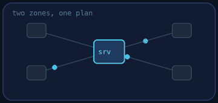
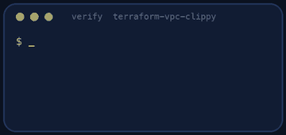
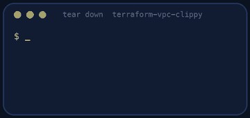

<p align="center"></p>

| | |
|-|-|
| **Time** | 90-105 min |
| **Cost** | free tier, a few cents |
| **You need** | An AWS administrator user (the IAM lab), the AWS CLI v2, Terraform 1.10 or newer, git and a terminal, and curl |

## How this lab works

1. **Fork** this repository to your own GitHub account (button at the top right).
2. Clone **your fork** in your Ubuntu environment (WSL on Windows, your OrbStack machine on Mac).
3. Read the lab below (the same text is in [`LAB.md`](LAB.md)) and follow the mission.
4. Answer the questions in [`SUBMISSION.md`](SUBMISSION.md). Where a question asks for output, paste it in a code block. No screenshots needed.
5. Commit and push. Open the **Actions** tab of your fork (click *I understand my workflows, go ahead and enable them* the first time). The **Lab check** shows what is still missing.
6. When the check is green, **submit the URL of your fork** in the course platform.

> [!NOTE]
> The check only looks at your answers and any files the lab asks you to commit. Your instructor reads your work and may ask you to explain any line.

<p align="center"></p>

## 🎬 The situation

<p align="center"></p>

Clippy needs a staging server so the team can test releases before customers see them. Last quarter somebody built one by clicking through the console. Then that person went on holiday, a disk filled up and nobody could rebuild it: nobody knew which subnet, which security group rules, which image or which commands had been used.

You will write the staging environment as Terraform, so that it can be created, destroyed and created again **identically**, by anyone, with one command. The real test of Infrastructure as Code is not that it works once. It is that you can delete everything and get it back.

> [!IMPORTANT]
> **Your mission**
> - Write the network: a VPC, an internet gateway and **two public subnets in two availability zones** (without copy-pasting a block)
> - Write the server and its firewall: HTTP for everyone, SSH for **one address** only
> - Boot Clippy on it through user data and open it in a browser
> - Destroy it and rebuild it, then prove it and tear it down

**Time:** 90-105 min | **Cost:** free tier, a few cents | **You need:** an AWS administrator user, the AWS CLI v2, Terraform 1.10 or newer, git, curl and a terminal. Everything uses `us-east-1`.

<p align="center"></p>

## Part 0 - Look before you write

1. **Fork** this repository and clone it. Open `terraform/`: `main.tf` has the provider and a list of `TODO`s, `variables.tf` and `outputs.tf` are mostly empty, and `userdata.sh.tftpl` is provided complete.
2. Read `userdata.sh.tftpl`. It is a shell script that the server runs **once, as root, the first time it boots**. What does it install? How does it start Clippy? Which line asks the instance for its own public IP, and why does it first ask for a token (this is IMDSv2)?
3. Get your public IP; you will need it:

```bash
curl -s https://checkip.amazonaws.com
```

> [!NOTE]
> **Think** If the server runs `apt-get install` at boot, it needs internet access *from inside the VPC*. Which resource of your network gives it that, and what happens at boot if it is missing?

<p align="center"></p>

## Part 1 - The network

In `main.tf` do TODO 1 and 2. Create the VPC (CIDR from `var.vpc_cidr`), the internet gateway and **two** public subnets in **two different availability zones**.

Rules:

- **One** `aws_subnet` block, not two. Use `count` (or `for_each`).
- Use the `cidrsubnet()` function to carve each `/24` out of the VPC range. Try it first in `terraform console`:

```bash
cd terraform
terraform init
terraform console
> cidrsubnet("10.20.0.0/16", 8, 0)
> cidrsubnet("10.20.0.0/16", 8, 1)
```

- One route table with `0.0.0.0/0` to the internet gateway, associated with **both** subnets.

Run `terraform plan` and read it. Count the resources before you apply.

> [!NOTE]
> **Think** Why two availability zones if only one server will run? What does a second zone cost you today and what does it let you do tomorrow?

<p align="center"></p>

## Part 2 - The firewall and the variable that has no default

Do TODO 5 first (`variables.tf`): the variable `my_ip_cidr`, **with no default** and with a `validation` block that rejects anything that is not a valid CIDR (`can(cidrhost(var.my_ip_cidr, 0))` is the usual trick). Try to run `terraform plan` without giving it a value: Terraform will ask you.

Pass it without writing it in a committed file:

```bash
export TF_VAR_my_ip_cidr="$(curl -s https://checkip.amazonaws.com)/32"
```

Then TODO 3: the security group with the three rules (HTTP from everywhere, SSH from `var.my_ip_cidr` only, all traffic out).

> [!NOTE]
> **Think** Why must `my_ip_cidr` have no default? What would a default of `0.0.0.0/0` mean for everybody who forgets to set it? And what happens to your SSH access the day your internet provider changes your address?

<p align="center"></p>

## Part 3 - The server

TODO 4: the `aws_instance`. Read the TODO list carefully: size, image, subnet, IMDSv2, `templatefile()`, the name tag, and `depends_on` for the route table association. Add the outputs (TODO 6).

```bash
terraform fmt
terraform plan
terraform apply
```

Open the `url` output in your browser. It may take a minute or two: the server is still installing when Terraform says it is done. Terraform manages the *machine*, not what finishes running inside it.

```bash
curl -s -X POST "$(terraform output -raw url)shorten" -H 'Content-Type: application/json' -d '{"url":"https://ironhack.com"}'
```

> [!NOTE]
> **Think** Terraform said "Apply complete" and the page still did not load. Where do you look to find out whether the user data finished? (Hint: `/var/log/cloud-init-output.log`, and how would you read it without SSH keys?)

<p align="center"></p>

## Part 4 - Destroy it. Build it again.

```bash
terraform destroy
terraform apply
```

Compare the two applies. Is the public IP the same? Is the URL you sent to your colleagues still valid? Why?

> [!NOTE]
> **Think** Everything else came back identical, but the address changed. Which AWS resource gives you an address that survives a rebuild, and what does it cost when it is *not* attached to a server?

<p align="center"></p>

## Part 5 - Prove it

<p align="center"></p>

```bash
./verify.sh
```

It checks your code, reads the **real resources** (two zones, routes, firewall, IMDSv2, no NAT Gateway) and uses the app. It also runs `terraform plan` and requires "no changes". Fix what is red and run it again until it ends with **ALL CHECKS PASSED**.

> [!TIP]
> **Stuck?** `Error: No valid credential sources`: `aws sts get-caller-identity` first. `healthz` never answers: the instance is not in a subnet routed to the internet gateway, or the user data failed (read `/var/log/cloud-init-output.log` through the EC2 console "Get system log"). `Unsupported argument` on `aws_vpc_security_group_ingress_rule`: you wrote the old inline rules; this lab uses the separate rule resources.

<p align="center"></p>

## Level up (optional)

- Add an `aws_eip` so the URL survives rebuilds. What changes in `verify.sh`'s view of the world?
- Put the instance type and the Clippy version in variables and set them with a `terraform.tfvars` file that stays out of git.
- Add a `check` block (or a `postcondition`) that fails the apply if the server has no public IP.
- Run `terraform graph | dot -Tpng > graph.png` and compare the picture with your plan.

<!-- teardown:start (generated by labs.py, do not edit) -->
## Tear down (mandatory)

<p align="center"></p>

Resources left behind cost money, keep doors open and pollute the next lab. Removing what you created is part of the job, so it is part of the submission: **you must prove it is gone**.

Do this **last**, after you have pasted your `verify` output into `SUBMISSION.md` (once you tear down, the lab can no longer be verified).

1. Run `./teardown.sh` (it runs `terraform destroy`). Everything is named after the lab tag.

Then run the proof:

```bash
./verify-teardown.sh
```

It prints a list of checks and must end with **TEARDOWN VERIFIED**. If it reports leftovers, remove them and run it again. Paste the full output in your submission.
<!-- teardown:end -->

<!-- submission:start (generated by labs.py, do not edit) -->
## 📬 Submission

Answer the questions in `SUBMISSION.md` in **your fork** (paste output in code blocks where asked), push, then submit the **URL of your fork**.

**Files to commit**

- `terraform/` with your `.tf` files (the provided `userdata.sh.tftpl` stays as it is)

**Questions to answer**

1. Paste `terraform output` and the response of `curl <url>/healthz`. Which resources did Terraform create and in which order? How did it know the order?
2. Show how you spread the subnets over two availability zones without copying the block twice (`count`, `for_each` or both). Why are two zones the minimum for anything you call highly available?
3. Your security group allows SSH from one address only. How did you get that address into Terraform without writing it in a file you commit? What happens to your access when your IP changes?
4. Run `terraform destroy` then `terraform apply` again and paste the end of both. Is the new public IP the same? What does that tell you about Elastic IPs and about what you hand to customers?
5. Which values did you turn into variables and which are `locals`? Name one value that should never have a default.
6. Paste the output of `./verify.sh`. It must end with **ALL CHECKS PASSED**.
7. **Tear down.** Paste the output of `./verify-teardown.sh`. It must end with **TEARDOWN VERIFIED**.
<!-- submission:end -->
